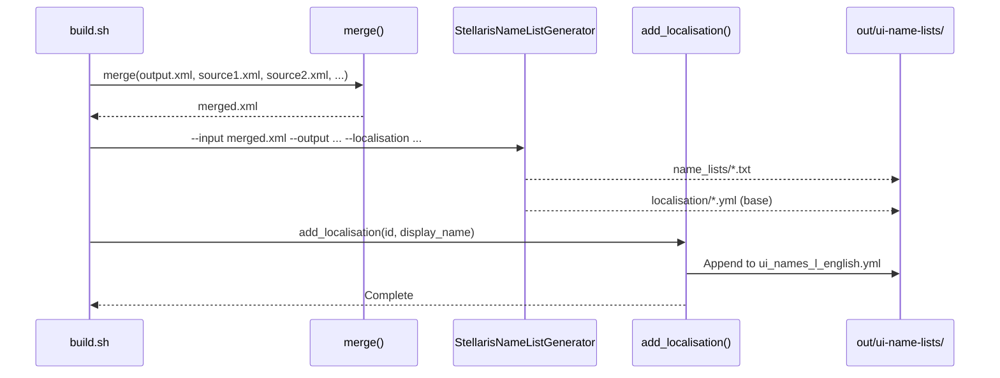

# Calendar Search Flow

## Name List Merging and Localisation Generation Flow

This document describes the core data transformation flow: merging multiple source name lists and generating localisation strings for Stellaris consumption.

### Sequence Diagram



### Merge Phase

#### Input Sources

Each composition variable in `build.sh` defines a space-separated list of source XML files:

```bash
HUMAN_EXTENDED_NAMELISTS="real/african/yoruba.xml real/african/zulu.xml media/starwars/human.xml ..."
```

#### Merge Algorithm

```bash
merge() {
    local output="$1"
    shift
    local inputs=("$@")

    # 1. Create root wrapper
    echo '<NameLists>' > "$output"

    # 2. Process each input file
    for input in "${inputs[@]}"; do
        local filepath="name-lists/$input"

        # Validate file exists
        [[ -f "$filepath" ]] || { echo "Missing: $filepath"; exit 1; }

        # Extract NameList elements (handles multiple per file)
        # Skip XML declaration, preserve all NameList children
        awk '/<NameList>/,/<\/NameList>/' "$filepath" >> "$output"
    done

    # 3. Close root wrapper
    echo '</NameLists>' >> "$output"
}
```

#### Merge Output Structure

```xml
<NameLists>
  <NameList>
    <Name>Yoruba</Name>
    <Type>human</Type>
    <NameGroup>
      <Name>First Names</Name>
      <Type>first</Type>
      <Values>
        <Value>Adebayo</Value>
        <Value>Folake</Value>
      </Values>
    </NameGroup>
    <NameGroup>
      <Name>Last Names</Name>
      <Type>last</Type>
      <Values>
        <Value>Adeyemi</Value>
        <Value>Okafor</Value>
      </Values>
    </NameGroup>
  </NameList>
  <NameList>
    <Name>Star Wars Human</Name>
    <Type>human</Type>
    <!-- ... -->
  </NameList>
  <!-- Additional NameLists from all sources -->
</NameLists>
```

### Generation Phase (StellarisNameListGenerator)

#### Input Processing

The generator reads the merged XML and:

1. **Groups by Type** — Collects all NameLists of the same species type
2. **Merges NameGroups** — Combines NameGroups with same Name+Type across sources
3. **Deduplicates Values** — Removes duplicate Value texts within each group
4. **Preserves Weights** — Maintains weight attributes for probabilistic selection
5. **Handles Special Types** — Processes ship, fleet, planet, army, ruler_title groups

#### Output: Name List Definitions (`common/name_lists/*.txt`)

Stellaris format (Clausewitz script):

```txt
name_list = {
    name = "human_extended"
    type = human

    name_group = {
        name = "First Names"
        type = first
        name = "Adebayo"
        name = "Folake"
        name = "Alexander"
        name = "Beatrice"
        # ... hundreds of names
    }

    name_group = {
        name = "Last Names"
        type = last
        name = "Adeyemi"
        name = "Okafor"
        name = "Smith"
        name = "Johnson"
        # ...
    }

    # Ship names
    name_group = {
        name = "Ship Names"
        type = ship
        name = "ISS Horizon"
        name = "ISS Discovery"
    }
}
```

#### Output: Base Localisation (`localisation/english/*.yml`)

The generator produces base localisation for structural elements:

```yaml
l_english:
  ui_name_list_human_extended: "Human - Extended"
  ui_name_group_first_names: "First Names"
  ui_name_group_last_names: "Last Names"
  ui_name_group_ship_names: "Ship Names"
```

### Localisation Enrichment Phase (`add_localisation()`)

#### Purpose

The generator's base localisation only covers structural names (list names, group names). Individual name values need explicit localisation keys for translation support.

#### Algorithm

```bash
add_localisation() {
    local id="$1"              # e.g., "human_extended"
    local display_name="$2"    # e.g., "Human - Extended"
    local loc_file="$OUTPUT_DIR/localisation/english/ui_names_l_english.yml"

    # 1. Ensure list name entry exists (generator may have created it)
    # 2. Extract all values from generated name list output
    local name_list_file="$OUTPUT_DIR/common/name_lists/00_ui_name_lists.txt"

    # Parse name groups and values from generated output
    # For each value, generate localisation key
    while read -r group_name value; do
        local key="ui_name_value_$(sanitize "$value")"
        echo "  $key: \"$value\"" >> "$loc_file"
    done < <(extract_values "$name_list_file" "$id")
}
```

#### Key Generation Rules

| Input Value | Sanitised Key | Example |
|-------------|---------------|---------|
| `Alexander` | `ui_name_value_alexander` | Lowercase, spaces→underscores |
| `O'Reilly` | `ui_name_value_o_reilly` | Apostrophes removed |
| `von Bismarck` | `ui_name_value_von_bismarck` | Particles preserved |
| `Jean-Luc` | `ui_name_value_jean_luc` | Hyphens→underscores |

#### Final Localisation Output

```yaml
l_english:
  # Structural (from generator)
  ui_name_list_human_extended: "Human - Extended"
  ui_name_group_first_names: "First Names"
  ui_name_group_last_names: "Last Names"

  # Values (from add_localisation)
  ui_name_value_adebayo: "Adebayo"
  ui_name_value_folake: "Folake"
  ui_name_value_alexander: "Alexander"
  ui_name_value_beatrice: "Beatrice"
  ui_name_value_adeyemi: "Adeyemi"
  ui_name_value_okafor: "Okafor"
  ui_name_value_smith: "Smith"
  ui_name_value_johnson: "Johnson"
  # ... thousands of entries
```

### Data Flow Summary

```
Composition Variable (build.sh)
         │
         ▼
    merge() ──────────────────► build/merged_human_extended.xml
         │                            │
         │                            ▼
         │                   StellarisNameListGenerator
         │                            │
         │              ┌─────────────┴─────────────┐
         │              ▼                           ▼
         │     common/name_lists/              localisation/english/
         │     00_ui_name_lists.txt                *.yml (base)
         │              │                           │
         │              └─────────────┬─────────────┘
         │                            ▼
         │                   add_localisation()
         │                            │
         ▼                            ▼
    Complete              localisation/english/
                         ui_names_l_english.yml (enriched)
```

### Edge Cases Handled

| Case | Handling |
|------|----------|
| Duplicate values across sources | Deduplicated by generator (exact text match) |
| Same group name, different types | Preserved as separate groups (type distinguishes) |
| Missing Values in source | Skipped (validation catches empty Values) |
| Special characters in names | Sanitised for localisation keys; preserved in values |
| Very long names | No truncation; Stellaris handles display |
| Non-ASCII characters | Preserved in UTF-8; keys use ASCII sanitisation |

### Performance

- **Merge**: O(n) where n = total source files (~100-200 per composition)
- **Generator**: O(m) where m = total names (~10,000-50,000 per composition)
- **Localisation**: O(m) for key generation
- **Total per composition**: ~2-5 seconds
- **Full pipeline (50 compositions)**: ~2-4 minutes