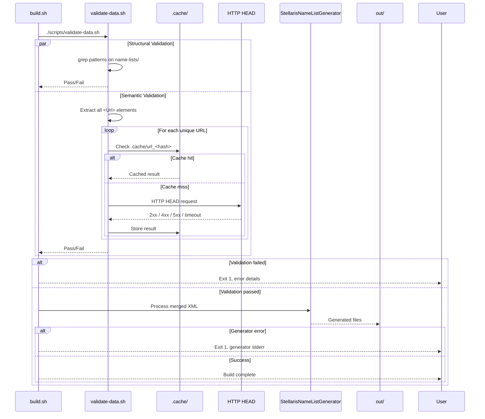

# Detail Mutation Flow

## Validation and Error Handling Flow

This document describes the validation pipeline and error handling flow that ensures data integrity before and during the build process.

### Sequence Diagram



### Structural Validation (`validate-data.sh`)

#### Validation Rules

| Rule ID | Check | Pattern | Rationale |
|---------|-------|---------|-----------|
| V001 | Double NameList tags | `<NameList>.*<NameList>` | Prevents nested NameList elements |
| V002 | Empty Values element | `<Values>\s*</Values>` | Ensures every group has names |
| V003 | Empty Value element | `<Value>\s*</Value>` | Prevents placeholder entries |
| V004 | Multiple Characters | `<Characters>.*<Characters>` | Only one character set per list |
| V005 | Url in Values | `<Values>.*<Url>` | Url must be at NameList level |
| V006 | Name outside NameGroup | Complex (see below) | Name must be child of NameGroup |
| V007 | Malformed nesting | Various | Catches unclosed tags, wrong hierarchy |

#### Name Outside NameGroup Check (V006)

```bash
check_name_outside_group() {
    # Find <Name> elements not directly inside <NameGroup>
    # Valid: <NameGroup><Name>...</Name></NameGroup>
    # Invalid: <NameList><Name>...</Name></NameList> (list name is OK)
    # Invalid: <Values><Name>...</Name></Values> (wrong place)

    local errors=$(grep -rn "<Name>" name-lists/ | \
        grep -v "<NameGroup>" | \
        grep -v "</NameGroup>" | \
        grep -v "<NameList>" | \
        grep -v "</NameList>" | \
        grep -v "<Value>" | \
        grep -v "</Value>")

    if [[ -n "$errors" ]]; then
        echo "Name outside NameGroup:"
        echo "$errors"
        return 1
    fi
}
```

#### Execution Order

```bash
main() {
    check_double_tags || exit 1
    check_empty_values || exit 1
    check_empty_value || exit 1
    check_multiple_characters || exit 1
    check_url_in_values || exit 1
    check_name_outside_group || exit 1
    check_malformed_nesting || exit 1
    validate_urls || exit 1

    echo "All validation checks passed"
}
```

### Semantic Validation: URL Reachability

#### URL Extraction

```bash
extract_urls() {
    # Extract all <Url>...</Url> content from all XML files
    grep -rho "<Url>[^<]*</Url>" name-lists/ | \
    sed 's/.*<Url>\(.*\)<\/Url>.*/\1/' | \
    sort -u
}
```

#### Cache Strategy

```bash
CACHE_DIR="$REPO_DIR/.cache"
mkdir -p "$CACHE_DIR"

check_url() {
    local url="$1"
    local cache_file="$CACHE_DIR/url_$(echo -n "$url" | sha256sum | cut -d' ' -f1)"

    # Check cache (valid for 7 days)
    if [[ -f "$cache_file" ]] && [[ $(find "$cache_file" -mtime -7) ]]; then
        cat "$cache_file"
        return
    fi

    # HTTP HEAD request with timeout
    if curl -sfI --max-time 10 "$url" >/dev/null; then
        echo "OK" > "$cache_file"
        echo "OK"
    else
        echo "FAIL" > "$cache_file"
        echo "FAIL"
    fi
}
```

#### Validation Loop

```bash
validate_urls() {
    local failed=0
    for url in $(extract_urls); do
        local result=$(check_url "$url")
        if [[ "$result" != "OK" ]]; then
            echo "ERROR: Unreachable URL: $url"
            failed=1
        fi
    done
    return $failed
}
```

### Generator Error Handling

#### Common Generator Errors

| Error Type | Cause | Resolution |
|------------|-------|------------|
| XML parse error | Malformed merged XML | Check merge output; validate source XML |
| Duplicate name list ID | Two sources define same ID | Ensure unique NameList names in composition |
| Invalid species type | Unknown Type value | Use Stellaris-native types only |
| Missing required group | No first/last names for human | Add required NameGroups |
| Output permission denied | `out/` not writable | Check directory permissions |

#### Error Capture

```bash
run_generator() {
    local merged_xml="$1"
    local output_dir="$2"

    if ! "$MOD_BUILDER_DIRECTORY/StellarisNameListGenerator" \
        --input "$merged_xml" \
        --output "$output_dir/common/name_lists" \
        --localisation "$output_dir/localisation/english" \
        --mod-name "$MOD_NAME" \
        --mod-version "$VERSION" 2>&1; then

        echo "Generator failed for $merged_xml"
        return 1
    fi
}
```

### Build-Level Error Handling

#### Fail-Fast Configuration

```bash
# In build.sh
set -euo pipefail
# -e: Exit on any command failure
# -u: Treat unset variables as error
# -o pipefail: Pipeline fails if any command fails
```

#### Error Context Preservation

```bash
build() {
    local id="$1"
    local display_name="$2"
    local sources="$3"

    echo "Building: $display_name ($id)"

    local merged_xml="$BUILD_DIR/merged_${id}.xml"

    # Merge with context
    if ! merge "$merged_xml" $sources; then
        echo "FAILED: Merge failed for $id"
        return 1
    fi

    # Generate with context
    if ! run_generator "$merged_xml" "$OUTPUT_DIR"; then
        echo "FAILED: Generation failed for $id"
        return 1
    fi

    # Localisation with context
    if ! add_localisation "$id" "$display_name"; then
        echo "FAILED: Localisation failed for $id"
        return 1
    fi

    echo "SUCCESS: $display_name"
}
```

#### Main Loop Error Handling

```bash
main() {
    # ... initialisation ...

    local failed=0

    for composition in "${COMPOSITIONS[@]}"; do
        # Parse composition: id|display_name|variable
        IFS='|' read -r id display_name var <<< "$composition"

        if ! build "$id" "$display_name" "${!var}"; then
            failed=1
            # Continue building others to surface all errors
        fi
    done

    if [[ $failed -eq 1 ]]; then
        echo "BUILD FAILED: One or more name lists failed"
        exit 1
    fi

    generate_mod_descriptor
    create_release_archives
}
```

### CI Error Reporting

#### GitHub Actions Annotations

```yaml
# In build.yml
- name: Validate
  run: ./scripts/validate-data.sh
  # Failures automatically annotated by GitHub

- name: Build
  run: ./scripts/build.sh
  # Failures show in log with context
```

#### Artefact Preservation on Failure

```yaml
- name: Upload build logs on failure
  if: failure()
  uses: actions/upload-artifact@v4
  with:
    name: build-failure-logs
    path: |
      build/
      .cache/
```

### Recovery Procedures

| Failure | Recovery Steps |
|---------|----------------|
| V001-V007 structural | Fix source XML in `name-lists/`; re-run `validate-data.sh` |
| URL unreachable | Verify URL; update or remove `<Url>` in source XML; clear `.cache/` |
| Generator XML parse | Check `build/merged_*.xml` for well-formedness; fix source |
| Generator duplicate ID | Rename NameList `<Name>` in one source; update composition |
| Permission denied | `chmod -R u+w out/`; check disk space |
| Network timeout (builder) | Retry; check `.builder/` cache; manual download if needed |

### Validation Coverage Matrix

| Layer | Coverage | Tool |
|-------|----------|------|
| XML well-formedness | Structural rules V001-V007 | grep/awk |
| URL validity | All `<Url>` elements reachable | curl + cache |
| Schema compliance | StellarisNameListGenerator input | Generator (runtime) |
| Output correctness | Stellaris load test | Manual / integration test |
| Localisation completeness | All values have keys | `add_localisation()` verification |

### Monitoring and Observability

- **Validation duration**: Logged implicitly by CI timing
- **URL cache hit rate**: `ls .cache/ | wc -l` vs unique URLs
- **Generator success rate**: Per-composition success/failure in build log
- **Build duration**: CI job duration metric