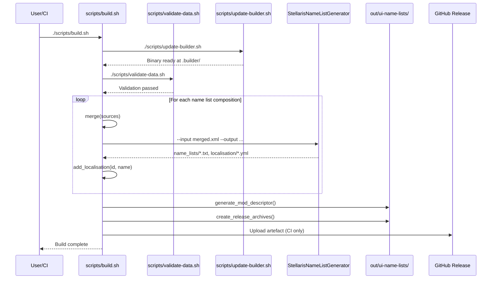

# Startup and Rendering Flow

## Build Pipeline Execution Flow

This document describes the complete build pipeline execution from invocation to final mod package creation.

### Sequence Diagram



### Detailed Steps

#### 1. Initialisation (`build.sh` entry)

```bash
set -euo pipefail
source "$SCRIPTS_DIR/common/paths.sh"

MOD_ID="ui_name_lists"
MOD_NAME="Universum Infinitum: Name Lists"
STELLARIS_VERSION="v4.3.*"
VERSION="${GITHUB_REF_NAME:-dev}"  # From CI or 'dev' locally
```

#### 2. Dependency Resolution (`update-builder.sh`)

```bash
# Check cache
if [[ -f "$MOD_BUILDER_DIRECTORY/StellarisNameListGenerator" ]]; then
    exit 0
fi

# Download from GitHub Releases
wget "https://github.com/hmlendea/stellaris-name-list-generator/releases/download/$BUILDER_VERSION/StellarisNameListGenerator-linux-x64.zip"
unzip -d "$MOD_BUILDER_DIRECTORY" "StellarisNameListGenerator-linux-x64.zip"
chmod +x "$MOD_BUILDER_DIRECTORY/StellarisNameListGenerator"
```

**Cache Location**: `.builder/StellarisNameListGenerator`

#### 3. Validation Gate (`validate-data.sh`)

```bash
# Structural validation
check_double_tags() { grep -r "<NameList>.*<NameList>" name-lists/ && exit 1; }
check_empty_values() { grep -r "<Values>\s*</Values>" name-lists/ && exit 1; }
check_empty_value() { grep -r "<Value>\s*</Value>" name-lists/ && exit 1; }
check_multiple_characters() { grep -r "<Characters>.*<Characters>" name-lists/ && exit 1; }
check_url_in_values() { grep -r "<Values>.*<Url>" name-lists/ && exit 1; }
check_name_outside_group() { ... && exit 1; }

# Semantic validation (URL reachability)
extract_urls() { grep -rho "<Url>[^<]*</Url>" name-lists/ | sed 's/.*<Url>\(.*\)<\/Url>.*/\1/'; }
for url in $(extract_urls | sort -u); do
    if ! curl -sfI "$url" >/dev/null; then
        echo "Unreachable URL: $url"
        exit 1
    fi
done
```

**Cache Location**: `.cache/url_<hash>`

#### 4. Composition Loop (per name list)

For each composition variable (50+ iterations):

```bash
build() {
    local id="$1"           # e.g., "human_extended"
    local display_name="$2" # e.g., "Human - Extended"
    local sources="$3"      # e.g., "$HUMAN_EXTENDED_NAMELISTS"

    # 4a. Merge sources
    local merged_xml="$BUILD_DIR/merged_${id}.xml"
    merge "$merged_xml" $sources

    # 4b. Generate via StellarisNameListGenerator
    "$MOD_BUILDER_DIRECTORY/StellarisNameListGenerator" \
        --input "$merged_xml" \
        --output "$OUTPUT_DIR/common/name_lists" \
        --localisation "$OUTPUT_DIR/localisation/english" \
        --mod-name "$MOD_NAME" \
        --mod-version "$VERSION"

    # 4c. Add localisation entries
    add_localisation "$id" "$display_name"
}
```

#### 5. Merge Function Detail

```bash
merge() {
    local output="$1"
    shift
    local inputs=("$@")

    echo '<NameLists>' > "$output"
    for input in "${inputs[@]}"; do
        # Extract NameList elements, skip XML declaration
        grep -A 10000 '<NameList>' "name-lists/$input" | \
        sed -n '/<NameList>/,/<\/NameList>/p' >> "$output"
    done
    echo '</NameLists>' >> "$output"
}
```

#### 6. Localisation Generation

```bash
add_localisation() {
    local id="$1"
    local display_name="$2"
    local loc_file="$OUTPUT_DIR/localisation/english/ui_names_l_english.yml"

    # Name list display name
    echo "  ui_name_list_${id}: \"$display_name\"" >> "$loc_file"

    # Extract groups and values from generated output
    # (Implementation reads StellarisNameListGenerator output)
}
```

#### 7. Mod Descriptor Generation

```bash
generate_mod_descriptor() {
    cat > "$OUTPUT_DIR/descriptor.mod" <<EOF
name="$MOD_NAME"
supported_version="$STELLARIS_VERSION"
tags={
    "Name List"
}
description="Provides numerous detailed name lists for empire creation, including an extensive Human - Extended variant with names inspired by historical and fictional sources."
picture="thumbnail.png"
EOF
}
```

#### 8. Release Packaging

```bash
create_release_archives() {
    local release_dir="$REPO_DIR/release"
    mkdir -p "$release_dir"

    local archive_name="ui-name-lists_${VERSION}.zip"
    cd "$OUTPUT_DIR/.."
    zip -r "$release_dir/$archive_name" "ui-name-lists/"
}
```

### CI-Specific Behaviour

In GitHub Actions (`build.yml`):

```yaml
- name: Build
  run: ./scripts/build.sh

- name: Upload artefact
  uses: actions/upload-artifact@v4
  with:
    name: ui-name-lists
    path: release/ui-name-lists_${{ github.ref_name }}.zip

- name: Create Release
  if: startsWith(github.ref, 'refs/tags/')
  uses: softprops/action-gh-release@v1
  with:
    files: release/ui-name-lists_${{ github.ref_name }}.zip
```

### Local Development Flow

```bash
# Clean build
rm -rf build/ out/ .builder/ .cache/
./scripts/build.sh

# Output at out/ui-name-lists/
# Test by copying to Stellaris mod directory:
# cp -r out/ui-name-lists/ ~/.local/share/Paradox Interactive/Stellaris/mod/
```

### Failure Points and Recovery

| Stage | Failure Cause | Recovery |
|-------|---------------|----------|
| update-builder.sh | Network, GitHub rate limit | Retry; check `.builder/` cache |
| validate-data.sh | XML error, unreachable URL | Fix source XML; check `.cache/` |
| merge() | Missing source file | Check composition variable paths |
| Generator | Invalid merged XML | Validate merged XML manually |
| add_localisation | Permission denied | Check `out/` directory permissions |
| Packaging | Disk space | Clean `build/`, `out/` |

### Performance Characteristics

- **Validation**: ~5-30s (depends on URL cache hits)
- **Builder download**: ~10-30s (first run only)
- **Generation**: ~2-5s per name list × 50 = ~2-4 minutes
- **Total CI build**: ~3-5 minutes
- **Local incremental**: ~30s (cached builder, cached URLs)